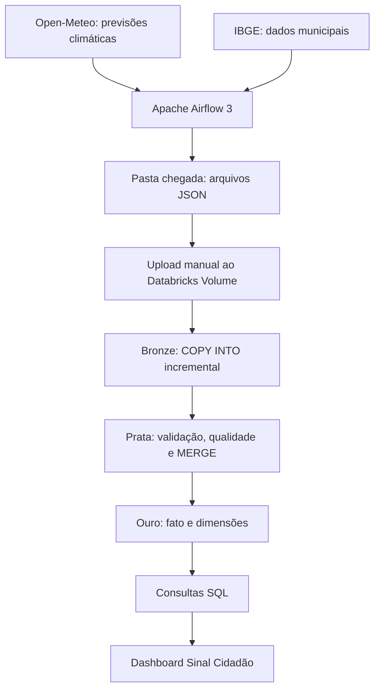

# Arquitetura de Dados — Sinal Cidadão

## Visão geral

O componente Big Data do Sinal Cidadão coleta informações
meteorológicas e municipais de fontes públicas e as
transforma em indicadores para apoiar análises urbanas.

## Diagrama do pipeline

## Fontes de dados

| Fonte | Dados | Formato | Frequência |
|---|---|---|---|
| Open-Meteo | Previsões de temperatura e precipitação | JSON | Diária |
| IBGE | Códigos e nomes de municípios | JSON | Diária |

## Airflow

A DAG `gs_sinal_cidadao_coleta` realiza duas coletas
em paralelo e verifica a chegada dos arquivos.

Os arquivos são armazenados inicialmente na pasta
local `chegada/`.

## Bronze

Os arquivos JSON são enviados ao Volume do Databricks.

O comando `COPY INTO` realiza ingestão incremental,
evitando reprocessar arquivos já carregados.

## Prata

O processamento aplica:

- Conversão de tipos.
- Tratamento de nulos.
- Validação de valores.
- Regras de qualidade com contagens.
- MERGE para atualização e inserção.
- Controle de duplicações por chave.

## Ouro

O modelo dimensional contém:

- dim_municipio
- dim_tempo
- fato_clima

A tabela fato registra previsões climáticas por
município de referência e horário.

## Contrato com o produto

O dashboard analítico consulta dados da Ouro,
principalmente a tabela:

`workspace.sinal_cidadao.fato_clima`

O painel apresenta:

1. Municípios cadastrados.
2. Horários analisados.
3. Temperatura média prevista.
4. Precipitação prevista.
5. Horários com previsão de chuva.

O dashboard demonstra o consumo da camada Ouro.

A integração direta desses dados com o controlador
semafórico não foi implementada nesta entrega.

## Benefício esperado para o cidadão

O Sinal Cidadão pretende oferecer maior transparência
sobre condições que podem influenciar a mobilidade
urbana e apoiar o planejamento de intervenções em
cruzamentos próximos a escolas, hospitais e pontos
de ônibus.

As previsões climáticas podem fornecer informações
complementares para análises de operação urbana.

Entretanto, os resultados desta implementação não
comprovam redução real de congestionamentos, tempo
de espera, acidentes ou emissões de CO2.

Esses benefícios deverão ser avaliados posteriormente
com dados operacionais dos cruzamentos e estudos
comparativos.

## Segurança e LGPD

O pipeline utiliza informações públicas e não realiza
tratamento de dados pessoais identificáveis.

Não são armazenados:

- Rostos.
- Placas.
- Nomes de pedestres.
- Documentos pessoais.
- Informações individuais de deslocamento.

Na arquitetura futura do MVP, as imagens deverão ser
processadas na borda, preservando apenas contagens
anônimas necessárias ao funcionamento do sistema.

## Limitações

- O Open-Meteo fornece previsões, não medições de trânsito.
- O painel é analítico e não controla semáforos reais.
- O envio entre Airflow e Databricks é manual na
  implementação acadêmica.
- A medição de impacto no trânsito exige fontes
  operacionais adicionais.

## Evidências

As capturas de tela das execuções estão disponíveis
na pasta `evidencias/`.
